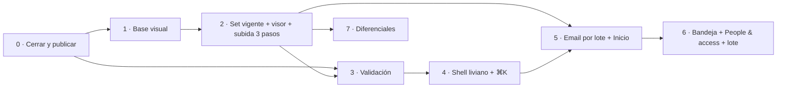

# SPEC — UI/UX: rediseño tipo gestor de proyectos y orden de integración

Fecha: 2026-10-10 · Revisado el mismo día: nuevo orden, menos alcance y correcciones técnicas (§0 y §4).
Alcance: portal, visor, admin y celular.

**Diseño de referencia:** lienzo "Rediseño UX Portal", con 10 pantallas enlazadas y notas por pantalla: https://claude.ai/artifact/FbCRzY5Q8DmsnWP1rcJtJs. El lienzo muestra el destino final; este documento decide qué se construye primero y qué queda afuera.

**Relación con las otras specs:**
- `SPEC-ux.md` (06/10) tiene los hallazgos pantalla por pantalla y la comparación con herramientas de planos (Procore, Autodesk Docs, Fieldwire, Dalux).
- `SPEC-rendimiento.md` tiene el trabajo de N+1 y latencia.
- Este documento **define el orden en que se integra todo**. Si algo se contradice, manda este documento.

---

## 0. Resumen

| Fase | Contenido | Duración (1 persona) | Cambios de base | Resultado |
|---|---|---|---|---|
| **0** | Cerrar lo abierto y **publicar** | ~1 semana | `db push` pendiente | Portal en `portal.mailantarki.com` con planos reales |
| **1** | Base visual mínima | 2 días | No | Tokens y piezas que necesitan las revisiones |
| **2** | **Set vigente, visor con revisiones y subida en 3 pasos** | 3–4 semanas | Sí (**riesgo mayor**) | Nadie abre ni carga una revisión equivocada |
| **3** | Validación con 3 usuarios | 1 semana (en paralelo) | No | Datos reales para decidir el resto |
| **4** | Shell liviano y búsqueda ⌘K | 1,5 semanas | 1 RPC + 1 índice | La app se recorre sin volver a la biblioteca |
| **5** | Email por lote al publicar; después, Inicio con novedades | 1–2 semanas | Sí + proveedor de email | Los usuarios se enteran sin buscar |
| **6** | Admin: bandeja, People & access y acciones en lote | 1,5–2 semanas | Menores | El admin ve qué hacer al entrar |
| **7** | Diferenciales (celular avanzado, QR, ZIP, comparar) | a definir | Según el ítem | Diferenciales frente a un portal genérico |

**Producción con lo que evita errores en obra (fases 0–2): 4–5 semanas. Total 0–6: 9–11 semanas.**

**Por qué este orden:**
1. **Publicar primero.** Hasta el 10/10 no hay usuarios reales. Cada fase posterior se decide mejor con uso real que con supuestos.
2. **Set vigente antes que el shell.** Abrir una revisión superada es el error más caro en obra, y hoy nada lo evita. El set vigente es sobre todo base de datos, listado y visor: no depende de cómo se vea el marco de la app, así que no hay retrabajo.
3. **Subida en 3 pasos junto con el set vigente.** Clasificar cada archivo ("revisión nueva", "conflicto", "falta número") necesita saber cuál es la vigente, y es el otro error caro: cargar mal.
4. **Validar antes del shell.** Las referencias del lienzo (Linear, Notion, Jira) son herramientas de uso diario. Los usuarios del portal son, en su mayoría, ocasionales: el cliente, el contratista en obra con el celular, el consultor con código. Las sesiones de la Fase 3 dicen cuánto shell y cuántos atajos hacen falta.
5. **Novedades después del set vigente.** "Updated" significa "hay una revisión vigente nueva", y eso no existe hasta la Fase 2.
6. **Admin por bandeja al final.** Se apoya en los eventos de documentos (Fase 5) y en las revisiones (Fase 2).

### Dependencias

---

## 1. Decisiones

| # | Decisión | Antes de | Estado |
|---|---|---|---|
| 1 | Idioma | — | ✅ 06/10: la interfaz queda en inglés. |
| 2 | Revisión vigente explícita o deducida | Fase 2 | ✅ Explícita y visible antes de publicar: al subir, cada archivo dice qué va a pasar ("New revision · Rev B becomes superseded"); por defecto manda el orden de revisión, y "Make current" corrige a mano. |
| 3 | Orden shell ↔ set vigente | Fase 2 | ✅ 10/10: set vigente primero. |
| 4 | URL del Inicio | Fase 5 | `/projects` pasa a ser el Inicio; los proyectos siguen en `/projects/[slug]`. No se rompen links. |
| 5 | Admin: Users + Codes | Fase 6 | Un ítem "People & access" que agrupa `/admin/users` y `/admin/codes` como pestañas. Las URLs no cambian. |
| 6 | Proveedor de email | Fase 5 | Resend o Postmark. El SMTP incluido en Supabase no sirve para producción. |
| 7 | Envío diario (digest) | Fase 5 | Cron de Vercel que llama a una ruta protegida. Solo si las sesiones lo piden; el email por lote va primero. |
| 8 | Offline en celular | Fase 7 | Decidir si los PDFs guardados offline se registran en `access_logs` al abrirlos sin red. |
| 9 | Descarga de una revisión superada | Fase 2 | ✅ Se permite a quien tenga permiso de descarga, pero el archivo se llama `… (SUPERSEDED Rev B).pdf` y el visor muestra el aviso. Bloquearla le quitaría el historial al consultor. |
| 10 | Mover documentos de disciplina | Fase 6 | ✅ Fuera de alcance: la disciplina es parte de la identidad del archivo en Storage (`set_document_path` la vuelve inmutable). Corregir una disciplina = archivar y volver a subir. |

---

## 2. Punto de partida (10/10)

| Ítem | Estado |
|---|---|
| Recuperar contraseña, login con "Forgot password?" y "Have a project code?" | ✅ |
| Users con filtros que se aplican solos; Codes con Extend/Revoke; Codes y Logs en tarjetas en celular | ✅ |
| Subida: número, título y revisión leídos del nombre del archivo, "Apply to all" | ✅ |
| Link desde la landing (`mailantarki.com`): "Client portal" y "Project documents", con vuelta al proyecto después del login (`?next=`) | ✅ |
| Rendimiento §3.0–3.6 y migración `20261006000200_document_counts_first_round` | ✅ en código · ❌ falta `db push` |
| **Regresión encontrada el 10/10:** con los cambios de rendimiento, un *member* no veía ningún proyecto (la consulta de proyectos corría bajo RLS y la política `organizations_select` no le devuelve su organización) | ✅ corregida, con test de integración con sesión real de member |
| **Bug de base encontrado el 10/10:** `organizations_select` compara `pr.organization_id = id`, pero `id` se resuelve como `pr.id`, así que nunca coincide | ✅ migración nueva que lo corrige, con test pgTAP |
| e2e que siembran PDFs (`seed-test-document.ts`) se colgaban esperando confirmar el host | ✅ los hosts locales no piden confirmación |
| Logs: campo "Document ID" (pide un UUID) y botón "Filter" | ❌ Fase 0 |
| Producción: Vercel, `portal.mailantarki.com`, Supabase Auth URLs | ❌ Fase 0 (pasos en la conversación del 07/10) |

---

## 3. Fases

Formato de cada fase: **objetivo · base de datos · cambios · criterios de cierre · riesgos**.

Reglas comunes:
- **Una PR por fase.** La Fase 2 puede ir en 3 PRs (2a base, 2b portal, 2c admin).
- **Migraciones primero.** `supabase db push` va antes que el código y cada migración lleva su test pgTAP. Nunca se edita una migración aplicada.
- **Sin dependencias nuevas** salvo el proveedor de email (Fase 5).
- **Cierre de cada fase:** `npm run lint`, `npm run typecheck`, `npm test` y `npm run test:e2e` en verde; capturas a 1440 px y 390 px; sin scroll horizontal a 390 px; skill `security-review` si toca permisos, RLS o Storage.

### Fase 0 · Cerrar lo abierto y publicar (~1 semana)

**Objetivo.** `main` limpio, el portal en producción y planos reales cargados.

**Cambios:**
1. Commitear en PRs: "rendimiento" (migraciones `20261006000100/200`, `list.ts`, `authorize.ts`, `proxy.ts`, `next.config.ts`), "Fase A UX" y "link desde la landing".
2. Terminar Logs:
   - Buscar por título o número de documento en lugar de "Document ID".
   - Filtros que se aplican solos con `FilterForm`.
   - Pestañas "Portal access" / "Admin activity".
3. Publicar: proyecto de Vercel del portal con las 5 variables, dominio `portal.mailantarki.com`, Site URL y Redirect URLs de Supabase Auth, `db push --include-seed`, administrador con `bootstrap-admin.ts`.
4. Cargar los planos reales de al menos un proyecto, con varias revisiones donde existan.

**Cierre:** `main` en verde, desplegado, y un member y un código de prueba entrando desde `mailantarki.com`.

### Fase 1 · Base visual mínima (2 días)

**Objetivo.** Las piezas que necesitan las revisiones, sin rehacer todos los botones todavía.

**Tokens nuevos en `src/styles/tokens.css`:**

| Token | Valor | Uso |
|---|---|---|
| `--new` / `--new-soft` / `--new-text` | `#137f78` / `#e2f1ef` / `#0f4f4a` | Badges New/Updated (Fase 5) |
| `--superseded-bg` / `--superseded-fg` | `#eef1ef` / `#57666a` | Revisiones superadas |
| `--warning-soft` / `--warning-text` / `--warning-line` | `#faedd2` / `#5c3b0c` / `#c58a2c` | Aviso de revisión superada, conflictos al subir |
| `--shadow-popover` | `0 12px 32px rgba(22,36,28,.25)` | Menús y paneles flotantes |

**Componentes en `src/components/ui/`:**

| Componente | Props clave | Notas |
|---|---|---|
| `StatusBadge` (ya existe) | sumar `superseded` | Punto + texto, no solo color. |
| `RevisionChip` | `rev`, `earlier?`, `href?` | Muestra "Rev C · 2 earlier". |
| `Segmented` | `options`, `value` | "Current set / All revisions". Links, no estado de cliente: la vista queda en la URL. |
| `Toast` (ya existe) | sumar `action?: { label, onClick }` | Para "Undo" (Fase 6). Los errores no se cierran solos. |

**Además:** mover los `:hover` nuevos bajo `@media (hover: hover)`. Los botones existentes se migran a un componente `Button` a medida que cada pantalla se toca, no en un barrido aparte.

### Fase 2 · Set vigente, visor con revisiones y subida en 3 pasos (3–4 semanas)

**Pantallas del lienzo:** *Project · current set*, *Viewer · revisions*, *Admin · upload, review, publish* y la parte de revisiones de *Admin · documents*. Equivale a la Fase B de `SPEC-ux` §8.

#### 2a · Base de datos

1. Columnas en `documents`: `is_current boolean not null default false`, `superseded_at timestamptz` y `superseded_by uuid references documents(id) on delete set null`. `authenticated` puede leerlas, no escribirlas: solo cambian por las funciones de abajo.
2. **Orden de revisiones:** `revision_sort_key(text)` (inmutable). Separa letras y números y los compara por tipo: `0 < 1 < 2 < … < A < B < … < Z < AA`; `P01 < P02`; `C < C1`. La misma regla vive en `src/lib/documents/revision.ts` (con los mismos casos de test) para que la pantalla de subida anticipe exactamente lo que va a hacer la base.
3. Índice parcial único `(project_id, segment_id, doc_number) where is_current and upload_status = 'ready' and archived_at is null`: nunca hay dos vigentes del mismo número.
4. **Backfill en la misma migración**, con la regla del punto 2 (desempata `issue_date` y después `created_at`). Antes de `db push`, `npx tsx scripts/preview-current-set.ts --env-file .env.production` lista los números con más de una revisión y cuál quedaría vigente, sin escribir nada. Si algo no convence, se corrige después con "Make current".
5. `finalize_document_upload` (misma firma) decide en la misma transacción, con un lock por número:
   - No hay vigente → la nueva queda vigente.
   - La nueva tiene revisión mayor → la nueva queda vigente y la anterior pasa a superada (`superseded_by` = nueva).
   - La nueva tiene revisión menor (carga de historial) → entra ya superada por la vigente.
6. `make_document_current(p_document_id)`: `security definer`, ejecutable por `authenticated` pero solo si `is_project_admin`. Deja vigente esa revisión, marca las demás como superadas y registra un `admin_events` (`document_made_current`).
7. **Archivar y restaurar:** si se archiva la vigente, pasa a vigente la mejor revisión que queda. Si se restaura una revisión y su número no tiene vigente, vuelve a serlo.
8. `document_counts` cuenta solo lo vigente.
9. Corrige `organizations_select` (ver §2).
10. pgTAP: una sola vigente por número; subir A y después B → A superada; subir A después de B → A entra superada; `make_document_current(A)` → B superada; archivar la vigente promueve la anterior; un member no puede ejecutar `make_document_current`; `authenticated` no puede escribir `is_current`.

#### 2b · Portal

| Pieza | Detalle |
|---|---|
| Set vigente por defecto | Una fila por número, con `RevisionChip` "Rev C · 2 earlier". `Segmented` "Current set / All revisions" (`?revisions=all`). En "All revisions" las superadas van en gris, con badge "Superseded", debajo de su vigente. |
| Contadores | Las pestañas de disciplina cuentan solo planos vigentes. |
| "2 earlier" | Link a `?revisions=all&q={número}`: el historial de ese plano en un clic. |
| Link fijo | `/projects/[slug]/documents/[docNumber]` abre siempre la vigente; `?rev=B` abre una puntual. Sirve para emails (Fase 5) y QR (Fase 7). Autoriza igual que el listado y responde 404 si no hay acceso. |
| Abrir desde la URL | `?open={id}` abre el visor al cargar la página (lo usa el link fijo). |

**Visor (`components/pdf/viewer.tsx`):**
- Selector de revisión con todas las del número ("Rev B · Superseded").
- Revisión superada: aviso ámbar "This revision was superseded on {fecha}" con "Open Rev C", y la marca "SUPERSEDED" sobre la página (no se modifica el PDF).
- Las revisiones salen de `GET /api/documents/[id]/revisions`, que autoriza con `authorize()` igual que la URL firmada. Se piden al abrir el visor, con `fetch` cancelable.

**No entra en esta fase** (pasa a la 4 o se descarta): panel lateral, menú "Display", agrupar por tipo, plano anterior/siguiente con J/K.

#### 2c · Admin

- **Documentos** agrupados por número: la fila muestra la vigente y un desplegable "N earlier revisions" con cada revisión, su estado y "Make current".
- "Upload new revision" en cada número: abre la subida con número, título, disciplina y tipo ya cargados (`?revisionOf={id}`).
- **Subida en 3 pasos: Add files → Review → Publish.**
  1. **Add files:** igual que hoy; los datos salen del nombre del archivo.
  2. **Review:** server action `classifyUploads(projectId, rows)` que autoriza y devuelve por fila:

     | Resultado | Cuándo |
     |---|---|
     | New drawing | El número no existe en esa disciplina |
     | New revision · Rev X becomes superseded | El número existe y la revisión nueva es mayor |
     | Earlier revision · added to history | El número existe y la revisión es menor que la vigente |
     | Conflict: Rev X already exists | Número y revisión ya existen. Sugiere "Use Rev {siguiente}" |
     | Missing number | No hay número. Campo en ámbar, obligatorio |

     Resumen arriba: "2 new revisions · 1 new drawing · 2 need attention". Editar una fila la vuelve a clasificar.
  3. **Publish:** "Publish N files" sube y publica solo las filas sin problemas; las demás quedan en la tabla para corregir.
- El resultado de la clasificación es un aviso: la base vuelve a decidir con la misma regla al publicar, así que dos admins subiendo a la vez no pueden dejar dos vigentes.

**Cierre de la Fase 2:**
- pgTAP de 2a en verde; tests de `revision.ts` con los mismos casos que la función SQL.
- Integración: subir A, subir B → el portal muestra solo B y A queda en el historial.
- e2e `e2e/current-set.spec.ts`: el link fijo abre B; abrir A muestra el aviso; "Make current" en A la vuelve vigente.
- e2e de subida: un archivo de cada resultado de la tabla de clasificación.
- Medición: `access_logs` permite contar vistas de revisiones superadas. La meta es casi cero.

**Riesgos:**
- **Backfill:** lo mitigan la vista previa sin escritura y "Make current".
- **Esquemas de revisión mixtos** (P01 preliminar → C01 construcción): el orden alfabético pone C antes que P. Se corrige con "Make current", y si se repite en obra se agrega un prefijo configurable por proyecto.

### Fase 3 · Validación con usuarios (1 semana, en paralelo)

Tres sesiones cortas (`SPEC-ux` §6): alguien en obra con celular, un consultor externo con código y un admin. Medir tiempo y errores en:
1. "Find the current revision of the north elevation."
2. "Download all current structure drawings."
3. "Give a contractor access to MEP only, for 2 weeks."
4. "What changed in Maylan Plaza since last week?"

Con el resultado se confirma o se recorta el alcance de las fases 4–6.

### Fase 4 · Shell liviano y búsqueda ⌘K (1,5 semanas)

**Shell** (más chico que el lienzo):
- Grupo `src/app/(portal)/` con `layout.tsx`; las URLs no cambian.
- Menú lateral simple: Home, la lista de proyectos visibles (son 6) y "Admin console" si corresponde. Sale de `visibleProjects()` con `cache()` de React, así layout y página comparten la consulta.
- `UserMenu` con nombre, rol, "Change password" y "Sign out"; visitantes con código: etiqueta del código y "Leave".
- Admin con su menú lateral: Overview, Projects & documents, People & access, Organizations, Activity log.
- Celular: barra inferior Home, Projects, Search, Account (objetivos de 44 px).
- Página de proyecto: encabezado compacto en lugar del hero grande, con breadcrumb y "Upload" para admins.

**Recortado:** proyectos fijados, selector de organización (hay una sola), menú colapsable con ⌘\, punto de novedades por proyecto (pasa a la Fase 5).

**⌘K** — se abre con ⌘K / Ctrl+K y desde la pestaña Search en celular:
- Migración `…_global_search.sql`: índice `(project_id, lower(doc_number))` y RPC `search_documents(q, p_limit)` `security invoker` que rankea número exacto, prefijo y texto, **solo revisiones vigentes** salvo que se pida el historial.
- **Visitantes con código:** la ruta usa el cliente admin y **filtra por sus grants dentro de la consulta, antes del límite**. Filtrar después del límite puede dejar la búsqueda vacía aunque haya resultados.
- `GET /api/search?q=` valida el principal y limita `q` a 2–80 caracteres; `fetch` cancelable con debounce de 150 ms.
- Un número exacto queda primero: "AR-101" + Enter abre el visor de la vigente.
- Actions para admins: "Upload PDFs to {proyecto}" y "Create access code".

**Panel lateral (opcional, según la Fase 3):** si se hace, el panel pide sus datos con `fetch` a `/api/documents/[id]/peek` y solo actualiza la URL (`history.replaceState`). Renderizarlo en el servidor con `?doc=` volvería a ejecutar la página entera, con todas sus consultas, en cada clic o flecha.

**Cierre:** e2e `shell-nav.spec.ts` (Home → proyecto → admin → volver, en 1440 y 390) y `command-palette.spec.ts` (⌘K, "AR-101", Enter → visor); un visitante no ve resultados fuera de sus grants.

### Fase 5 · Email por lote; después, Inicio con novedades (1–2 semanas)

**Necesita la decisión 6.**

**Primero, el email por lote:**
- `document_events(id, document_id, project_id, segment_id, kind, from_value, to_value, actor_id, batch_id, created_at)`, con `kind` en `published | revised | status_changed | archived | made_current`. Lo escriben `finalize_document_upload`, `make_document_current` y los cambios de estado.
- En "Publish" (Fase 2), la casilla "Email N people with access to {disciplinas}" manda **un email por lote** a quienes tienen acceso a esas disciplinas. El email lleva el link fijo, nunca una URL firmada.
- `project_watchers(user_id, project_id, enabled)`: encendido por defecto para los proyectos asignados; se apaga desde el email o el menú de usuario.

**Después, el Inicio** (`/projects`):
- "N updates in M projects since your last visit", agrupado por proyecto, con "Mark all as seen" (`user_project_visits`; cookie firmada para visitantes).
- "Recently viewed" desde `access_logs`.
- Todos los proyectos con portada; con un solo proyecto visible, redirige a ese proyecto.
- En el proyecto: aviso "2 changes since your last visit" con "Show only these" y badges New/Updated.

**Recortado:** frecuencia de email por proyecto y digest diario (salvo que la Fase 3 los pida).

**Cierre:** al subir 3 PDFs llega un único email, solo a quienes tienen acceso a esas disciplinas; e2e `home-feed.spec.ts`.

### Fase 6 · Admin: bandeja, People & access y acciones en lote (1,5–2 semanas)

**Overview (`/admin`):** contadores de 7 días y "Needs attention" con acción de un clic:

| Ítem | Condición | Acción |
|---|---|---|
| Códigos que vencen | Activos con `expires_at` en 7 días o menos | "Extend 30 days" |
| Invitados que no entraron | `last_sign_in_at` nulo y alta hace más de 3 días | "Resend invite" |
| Borradores viejos | `draft` hace más de 30 días | Link a Documentos filtrado |
| Subidas que no terminaron | `pending` hace más de 24 h | "Retry" / "Discard" |

Actividad agrupada por día con nombres de personas (vista `activity_feed` sobre `access_logs`, `admin_events` y `document_events`, `security_invoker`).

**People & access:** pestañas "Members · Guests with a code · Pending invites"; panel de la persona con matriz proyecto × disciplina, nivel "View only / View and download" y "Save access" en un paso.

**Acciones en lote en Documentos:**
- Checkbox por fila y "Select all N matching"; barra abajo: "Change status · Feature · Download · Archive".
- RPC `bulk_update_documents(p_ids, p_patch)` que admite solo `status`, `is_featured` y `archived_at`, autoriza por proyecto y devuelve los valores anteriores para "Undo" (toast de 10 s). Archivar más de 10 pide confirmación.
- Menú "⋯" por fila en lugar del botón rojo.
- **Sin "Move to discipline"** (decisión 10).

**Recortado:** posponer ítems de la bandeja (`admin_snoozes`).

### Fase 7 · Diferenciales (a definir)

Ordenados por valor/esfuerzo. El primero sube antes si la Fase 3 muestra problemas de zoom en celular:

| # | Ítem | Depende de | Esf. |
|---|---|---|---|
| 1 | Visor en celular: pellizco para zoom, deslizar entre planos, hoja inferior de revisiones | 2 | M |
| 2 | Texto del PDF en la búsqueda | 4 | M |
| 3 | ZIP del set vigente por disciplina, registrado en `access_logs` | 2 | M |
| 4 | QR por plano (link fijo) | 2 | S |
| 5 | Comparar revisiones (superposición y lado a lado) | 2 | L |
| 6 | Marca de agua para visitantes con código | — | L |
| 7 | Guardar offline por disciplina (PWA) | 2 + decisión 8 | L |
| 8 | Vínculos automáticos entre planos | 2 | L |

---

## 4. Qué cambió respecto de la versión anterior (10/10)

| Antes | Ahora | Por qué |
|---|---|---|
| Shell (F2) y ⌘K (F3) antes del set vigente (F4) | Set vigente en la Fase 2, shell y ⌘K en la 4 | El riesgo en obra pesa más que el retrabajo, que además casi no existe |
| Subida en 3 pasos junto con el lote (F5) | Subida en la Fase 2; lote en la 6 | La clasificación depende del set vigente; el lote no |
| Validación "antes de la Fase 4" | Fase 3 propia, después de publicar | Nadie usa el portal todavía |
| Panel lateral renderizado en el servidor con `?doc=` | `fetch` a una ruta propia, opcional | Cada clic re-ejecutaba la página entera |
| ⌘K de visitante filtrando por grants | Filtrar dentro de la consulta, antes del límite | Con el límite primero, la búsqueda podía quedar vacía |
| "Move to discipline" en lote | Fuera de alcance | La disciplina es inmutable en Storage |
| Backfill por `issue_date` | Por orden de revisión, con vista previa | `issue_date` puede estar vacío |
| Descarga de superadas sin definir | Permitida, con el nombre marcado | Decisión 9 |
| Fijados, selector de organización, menú colapsable, menú "Display", frecuencias de email, snooze | Recortados | 6 proyectos y una organización no los justifican |
| Barrido de todos los botones en la Fase 1 | Migración a `Button` a medida que se toca cada pantalla | Mismo resultado sin una fase entera de refactor |

## 5. Equivalencia con `SPEC-ux.md` §5/§8

| `SPEC-ux` | Acá |
|---|---|
| Fase A · mejoras rápidas | Fase 0 (casi todo hecho) |
| Fase B · revisión vigente | Fase 2 |
| Fase C · avisos | Fase 5 |
| Fase D · encontrar y entregar | ⌘K en Fase 4; lote en Fase 6; texto del PDF y ZIP en Fase 7 |
| Fase E · diferenciales | Fase 7 |
| §3.15 transversal (menú de usuario, nav en celular, formularios siempre abiertos) | Fases 4 y 6 |

## 6. Criterios que valen para todas las fases

- **Accesibilidad:** contraste de texto de 4,5:1 o más; foco visible; todo se puede hacer con teclado; botones reales; `aria-label` en botones de ícono; estados con punto + texto.
- **Celular:** objetivos de 44 px o más; sin scroll horizontal de página a 390 px; `:hover` solo con `@media (hover: hover)`.
- **Rendimiento:** ninguna fase agrega rondas secuenciales a Supabase en las pantallas medidas en `SPEC-rendimiento` §7. Lo que se carga después usa `fetch` cancelable.
- **Textos:** en inglés; los que se repiten van en `src/lib/copy.ts`.
- **Seguridad:** toda RPC nueva es `security invoker` o valida el principal adentro, y tiene test pgTAP de acceso. Nunca se exponen URLs firmadas en emails ni en links fijos. Toda decisión de permiso pasa por `authorize.ts`.

## 7. Métricas de producto

Desde `access_logs` y `document_events`:
- Vistas de revisiones superadas por semana: casi cero después de la Fase 2.
- Uso de ⌘K por usuario activo (Fase 4).
- Tiempo entre que se publica un plano y su primera vista: debería bajar con la Fase 5.
